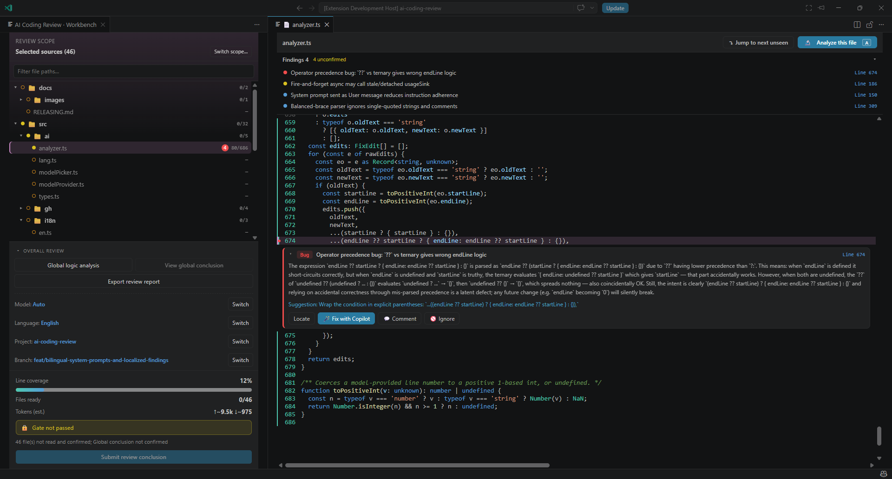
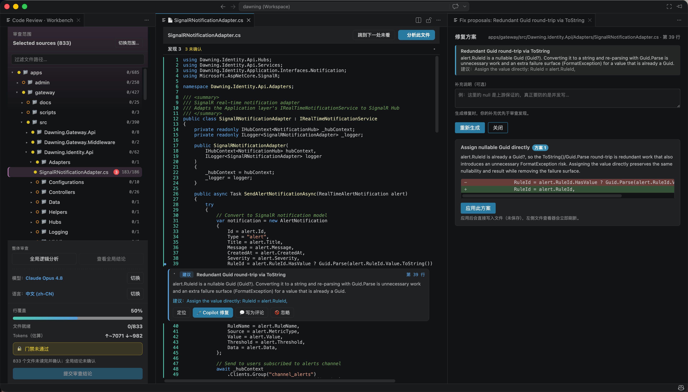

# AI Coding Review

> Distrust-driven code review: **every line must be looked at**. "Review = distrust" turned into a hard gate — read line-by-line + repository analysis rooted at each file + dispose of every verified finding + cross-file global analysis. Only when all of that is done are you allowed to submit a conclusion.

[](https://marketplace.visualstudio.com/items?itemName=changjian-wang.ai-coding-review)
[](https://marketplace.visualstudio.com/items?itemName=changjian-wang.ai-coding-review)
[](https://marketplace.visualstudio.com/items?itemName=changjian-wang.ai-coding-review)

VS Code extension · powered by the GitHub CLI and Copilot models

English | [简体中文](README.zh-CN.md)



<p><em>Live language switch preview (English ↔ 中文):</em></p>



## Core ideas

- **Review is distrust**: assume the author makes mistakes; no conclusion is allowed until the gate passes.
- **Per-line coverage is real**: based on a real VS Code editor + viewport tracking (`visibleRanges`) to judge that "the eyes actually scanned it", not a fake scroll; progress is bound to `headSha` — the moment the author pushes a new commit, old coverage is invalidated.
- **AI is a copilot, not a judge**: the model produces findings and fix proposals; whether to accept them is decided by a human, one finding at a time (fix / comment / ignore-with-reason).
- **Native first**: status bar, decorations, diagnostics use native VS Code APIs; the review workbench, document viewer, fix proposals, and global report use webviews for rich interaction.

## Features

### Review scope (workspace-first)

- The preparation page selects a local repository and a PR, a branch comparison with an explicit base, or a full branch snapshot. Choose an open repository or explicitly browse to another local repository.
- PR and branch scopes pin actual commits. Source, Diff, and related evidence come from the selected Git objects without implicit checkout, stash, or working-tree replacement. Missing PR objects are fetched for the selected GitHub PR; failures are explicit.
- Full snapshots list committed files, not untracked edits or another branch's working tree. Binary/non-UTF-8 content, symlinks, and submodules are explicitly rejected as regular text rather than silently treated as reviewed.
- Local file/folder reviews remain available through the root-locked tree picker, skipping `node_modules / .git / dist / out / bin / obj / .vs`. This mode reads working-tree files and open unsaved documents.
- Immutable snapshots do not apply or revert fixes against a different working tree. Explicitly select a local-file review to edit; verified delivery to the PR head is a later implementation stage.
- Persistence uses canonical repository-path identities, with commit/base/scope isolation for snapshots. Same-name folders do not share reviews. Ambiguous legacy folder-name history remains available as a separate archive, without automatically reusing approvals or patches.

Development status: the scope foundation, M2 preparation and the M3 requirement-aware review slice in the [Review vNext implementation plan](docs/REVIEW-VNEXT-IMPLEMENTATION-PLAN.zh-CN.md) are connected, not the entire vNext. The final three-stage workspace, Reviewer Reply/Resolve and real-model semantic evaluation remain outstanding. Snapshot evidence uses bounded searches, never another branch's language services.

### Requirement preparation (M2)

- Three preparation blocks select Repository/PR/branch, provide evidence, and inspect AI understanding. Add Markdown text, local UTF-8 Markdown/TXT, explicit public HTTP/HTTPS text or HTML URLs, GitHub Issue/PR bodies, or GitHub Markdown/TXT links.
- GitHub reads use the selected repository account. Ordinary pages receive no browser cookies or third-party credentials, and scripts are not executed. Private/local addresses, cross-origin redirects, unsupported formats, access failures and missing content are explicit errors; convert or paste PDF/Word, login-only or client-rendered content.
- Selected materials are sent to the chosen Copilot model to organize intent, explicit requirements, derived checks and unverified premises. Output structure and exact source-version/line quotations are checked before accepting understanding. Original snapshots and human revisions are stored separately in workspace state.
- A single confirmation binds the repository, head/base and source versions, with no per-item checkboxes or per-document role classification. Material or scope changes invalidate confirmation. Local files are rechecked before analysis and confirmation; URLs remain explicitly read snapshots with a re-read action.
- Markdown editing/preview and source provenance are available; HTML does not execute and images do not auto-load. File/URL originals are read-only and refreshed from their source; pasted material can be edited.
- Model errors, cancellation and unavailable models preserve material without auto-confirmation or reverse-engineering requirements from code. Explicit technical-only continuation does not erase known code issues and still requires the technical review gate.
- Each material is limited to 512,000 bytes, with at most 12 materials. Model input is also checked against 120,000 characters and the selected model's token limit; oversized content is rejected rather than silently truncated.

**Confirmation establishes intent and scope, not correctness or satisfaction.** It now starts M3 automatically. Until the current business review produces valid conclusions, requirement consistency remains unassessed; the older file/global analyzer cannot substitute for this workflow.

### Requirement-aware business review (M3 development slice)

- One confirmation or the workbench's business-review button runs planning, complete source segments, independent global discovery, requested contract/counterevidence, candidate verification and per-requirement/premise assessment. Opening or scrolling every file is not a prerequisite.
- Source intervals, old/new sides, hashes and exact quotations are tracked. Added files have no invented old side; deletion and rename baselines retain their original paths. Missing facts remain unknown; upstream safeguards can overturn local suspicions, and invalid requirement premises are classified separately from implementation defects.
- Known critical questions survive retries, technical-only mode and changed requirement identities. Notes, model agreement, confirmation or re-uploading the same normative text do not clear them. Only independently supported current facts can close them.
- Cancellation, failures, input changes and limits retain incomplete results. Exact-input completed calls can be reused; restored running work is interrupted, not silently completed. Current branch/PR endpoints, code and local requirement files are checked before using a conclusion.
- Approval requires complete source coverage and global analysis, no workflow limits/errors, no confirmed defects or decisive unresolved premises, and explicit report acknowledgement. Noncritical unknowns do not automatically prevent approval, but must not be described as satisfied. Partial findings may still support bounded comments or requested changes.
- The report supports source-snapshot reading and local Markdown export. Existing PR submission publishes only bounded coverage/status metadata and explicitly drafted review comments; private requirement originals, material paths and full source quotations are not automatically copied into its summary. Late receipts cannot approve a newer business run.
- Engine limits: 80 formal files, 24 units, 16,000-character segments, 100,000-character measured model inputs, 24 evidence requests/related files, 80 candidates, 128 model calls and a 180-second engine budget. The model's token capacity also applies. Startup/submission freshness checks are separate I/O. Limits are visible, not proof of a complete repository review.

This is source/contract reasoning, not executed tests or production calls. Controlled model fixtures validate orchestration and gates, **not real Copilot accuracy**; the independent semantic evaluation remains part of M0/M7.

### Review workbench

- File tree + per-file / overall coverage progress + findings summary + action buttons, all in one webview
- Can be popped out into a separate window (like "Open in Agents Window")
- Auto-restores the review and workbench after a window reload — no need to re-pick the scope
- **Token accounting (estimated)**: a HUD row shows estimated LLM tokens (↑input ↓output) with a per-operation breakdown on hover, accumulated over the review and persisted; estimated locally via `countTokens`, not the provider's billed counts

### Per-file review

- PR and other diff-backed scopes open in an uncollapsed, full-file inline Diff by default, with
  old/new line numbers and added/deleted rows; switch to the clean head file at any time
- Per-line coverage tracking and "jump to next unseen line"
- **Analyze from this file** recursively follows related definitions, callers, configuration, and tests under explicit depth/file/token/time budgets
- Every candidate bug receives an independent second model review against the same repository context; only confirmed bugs are shown, while disproved or unverified candidates are reported only in the completion summary
- Confirmed bugs may land in related files; out-of-scope bug locations are automatically added to the active review and must be reviewed normally
- Every actionable finding must be disposed: **fixed / commented / ignored (reason required)**
- Fix proposals: Copilot generates mutually-exclusive "multi-edit = one complete solution" candidates, one-click apply + one-click undo, with applied snapshots persisted
- **Reviewer context before a fix**: when the model's read of a finding is off, add a supplementary note in the fix panel; it overrides the finding when generating proposals and is persisted per finding
- Selection translation / code explanation annotations

### Global analysis

- Cross-file logic analysis, optionally scoped to selected directories
- A dedicated global-report webview

### Gate and conclusion

- Gate: **every file is analyzed and all findings are disposed** + **the global conclusion is confirmed**
- Conclusion: Approve / Request Changes / Comment
- When the scope is a PR, one click writes the conclusion back to the GitHub PR (`gh`); otherwise it is recorded locally

## Gate model

```text
gatePassed = all files ready && global analysis confirmed
file ready  = file-level analysis done && every actionable finding in the file disposed
```

Per-line coverage is shown as a live progress signal (per-file / overall `seen/total`) to push "actually read it", displayed alongside the gate verdict.

## Language (bilingual)

AI Coding Review is fully bilingual (English / 简体中文), **English by default**.

- `codereview.language` drives the **whole experience** — both the extension UI (status bar, prompts, webview panels) and all LLM output (findings, fix proposals, explanations, global conclusions).
  - `en` (default): everything in English
  - `zh-CN`: everything in Simplified Chinese
  - `auto`: follow the VS Code display language
- Switching the setting takes effect **live** — the status bar and any open webview panels re-render immediately, no reload needed.
- Command titles in the Command Palette follow the **VS Code display language** (a platform limitation for static contribution points), localized via `package.nls`.

## Commands and settings

### Commands

| Command | Description |
|---------|-------------|
| `codereview.openOrStart` | Open or start a review (status-bar entry) |
| `codereview.openInNewWindow` | Open the review workbench in a separate window |
| `codereview.startReview` | Pick a scope and start a review |
| `codereview.openWorkbench` | Open the review workbench |
| `codereview.analyzeFile` | Analyze repository behavior rooted at the current file |
| `codereview.globalAnalysis` | Run global analysis |
| `codereview.showGlobalReport` | Show the global report |
| `codereview.submitConclusion` | Submit the review conclusion |
| `codereview.jumpToNextUnseen` | Jump to the next unseen line |
| `codereview.pickModel` | Select the analysis model |
| `codereview.pickLanguage` | Switch the experience language (UI + LLM output) |

### Settings

| Setting | Default | Description |
|---------|---------|-------------|
| `codereview.language` | `en` | Language for the whole experience (UI + LLM output): `en` / `zh-CN` / `auto` |
| `codereview.focusedWorkbench` | `false` | When opening the workbench, hide the side bar / activity bar so it takes over the main editor area; restored on close |
| `codereview.repositoryAwareAnalysis` | `auto` | `auto` recursively builds related repository context and self-reviews candidate bugs; `off` keeps legacy single-file behavior |
| `codereview.repositoryContextTokenBudget` | `28000` | Maximum estimated repository-context input tokens; lower-value related excerpts are removed first |

## Architecture

```text
src/
  extension.ts          activation entry, command registration, orchestration, gate
  i18n/                 language resolver + English/Chinese message catalogs
  gh/                   GitHub CLI wrapper (auth / pr view / pr diff / write back review)
  scope/                review scopes: PR / branch diff / working tree / file selection + tree-picker webview
  review/               review session model + persistence (ReviewStore abstraction)
  ai/                   model selection + file-level / global analysis + fix proposals + language directive
  ui/                   workbench / document / fix-proposal / global-report webviews + status bar / toast / progress
```

## Persistence

- `workspaceState` (local), keyed by `repo + scopeId + headSha`.
- Applied-fix snapshots are persisted, so "undo fix" and "locate" still work after a reload.
- Progress is bound to `headSha`: old coverage is invalidated after the author pushes a new commit.
- Note: `workspaceState` **does not follow your GitHub account and is not cross-device**; cross-device capability is reserved via the `ReviewStore` interface for a future remote implementation.

## Model and language

- Lists the models currently authorized for Copilot via the VS Code Language Model API, supports `Auto`, and remembers the choice per workspace.
- `codereview.language` controls the language of the whole experience (UI + all LLM output); see [Language](#language-bilingual) above.

## Development and packaging

```bash
npm install
npm run compile            # or npm run watch; press F5 to launch the Extension Development Host
npm test                   # run the unit tests (vitest)
npm run package            # production build (esbuild --production)
npx @vscode/vsce package   # produce a .vsix
```

PR scope and writing back to a PR require the GitHub CLI installed and logged in: `gh auth login`.

## Roadmap

- [ ] Cross-device / account-following review progress (a remote `ReviewStore` implementation).
