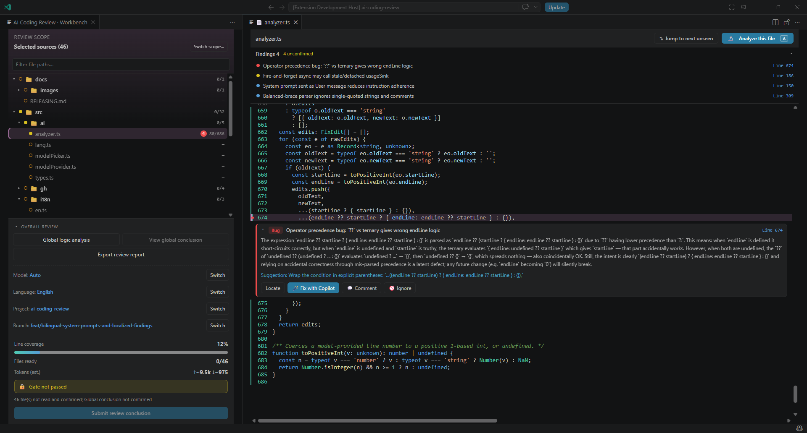
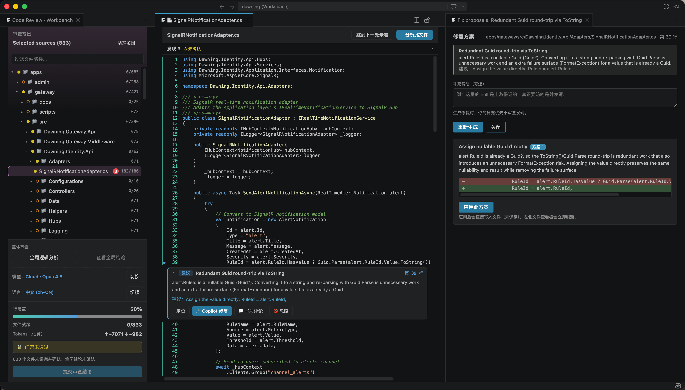

# AI Coding Review

> Distrust-driven code review: **every line must be looked at**. "Review = distrust" turned into a hard gate — read line-by-line + repository analysis rooted at each file + dispose of every verified finding + cross-file global analysis. Only when all of that is done are you allowed to submit a conclusion.

[](https://marketplace.visualstudio.com/items?itemName=changjian-wang.ai-coding-review)
[](https://marketplace.visualstudio.com/items?itemName=changjian-wang.ai-coding-review)
[](https://marketplace.visualstudio.com/items?itemName=changjian-wang.ai-coding-review)

VS Code extension · powered by the GitHub CLI and Copilot models

English | [简体中文](README.zh-CN.md)



<p><em>Live language switch preview (English ↔ 中文):</em></p>



## Core ideas

- **Review is distrust**: assume the author makes mistakes; no conclusion is allowed until the gate passes.
- **Per-line coverage is real**: based on a real VS Code editor + viewport tracking (`visibleRanges`) to judge that "the eyes actually scanned it", not a fake scroll; progress is bound to `headSha` — the moment the author pushes a new commit, old coverage is invalidated.
- **AI is a copilot, not a judge**: the model produces findings and fix proposals; whether to accept them is decided by a human, one finding at a time (fix / comment / ignore-with-reason).
- **Native first**: status bar, decorations, diagnostics use native VS Code APIs; the review workbench, document viewer, fix proposals, and global report use webviews for rich interaction.

## Features

### Review scope (workspace-first)

- The preparation page selects a local repository and a PR, a branch comparison with an explicit base, or a full branch snapshot. Choose an open repository or explicitly browse to another local repository.
- PR and branch scopes pin actual commits. Source, Diff, and related evidence come from the selected Git objects without implicit checkout, stash, or working-tree replacement. Missing PR objects are fetched for the selected GitHub PR; failures are explicit.
- Full snapshots list committed files, not untracked edits or another branch's working tree. Binary/non-UTF-8 content, symlinks, and submodules are explicitly rejected as regular text rather than silently treated as reviewed.
- Local file/folder reviews remain available through the root-locked tree picker, skipping `node_modules / .git / dist / out / bin / obj / .vs`. This mode reads working-tree files and open unsaved documents.
- Immutable snapshots do not apply or revert fixes against a different working tree. Explicitly select a local-file review to edit; verified delivery to the PR head is a later implementation stage.
- Persistence uses canonical repository-path identities, with commit/base/scope isolation for snapshots. Same-name folders do not share reviews. Ambiguous legacy folder-name history remains available as a separate archive, without automatically reusing approvals or patches.

Development status: the scope foundation, M2 preparation, M3 requirement-aware review and M4 review center in the [Review vNext implementation plan](docs/REVIEW-VNEXT-IMPLEMENTATION-PLAN.zh-CN.md) are connected, not the entire vNext. Reviewer feedback synchronization, Reply/Resolve and real-model semantic evaluation remain outstanding. Snapshot evidence uses bounded searches, never another branch's language services.

### Requirement preparation (M2)

- The new-window entry opens preparation directly, without a separate “Discover files” workbench tab while waiting for your choices. Confirmation hands the same panel to the review center; cancelling does not activate a new scope.
- Standard and separate-window entries share one handoff, including a first start without an active review. Preparation stays in its original panel with inline opening progress; loading failures remain there with an actual reason and retry, rather than closing the window and leaving only a notification. Saved material, selected scope and the exact tab/window are retained.
- Candidate scope and confirmed requirements are saved before replacing the active review. A failed transfer preserves the original scope, report and manual conclusion; cancellation returns to them unchanged. An explicit other-repository argument prepares that repository in the existing center instead of being ignored; browsing and cancellation alone do not switch the active scope.
- Returning from review or conclusion displays the complete three-block preparation form in the same tab, not another preparation tab or a placeholder. Use the stage navigation to return, or Escape to go back to the prior stage. Navigation alone does not cancel or restart an unchanged review. Background progress/language refreshes cannot replace preparation; saved material and exact conclusion drafts survive the round trip, while real requirement changes still invalidate old analysis.
- **Choose another local repository** is the last action in the Repository dropdown. It selects an existing Git folder without cloning or opening another VS Code window; cancelling preserves the current repository, PR and material. The card's refresh action reloads PR or repository/branch choices, while **Retry reading scope** handles source-loading errors separately from AI-understanding retries.
- PR lists and selected code scopes load locally inside the target card, with a fixed-height selector, reserved status line and small indicator, not a full-page transition or invented percentage. After five seconds a slow-response hint appears. Material input stays available while waiting; organizing requirements or starting review waits for a current scope. Only an actual model call is labelled AI analysis.
- The first PR is not auto-selected. Refresh retains the previous list and selection without treating them as current. Empty results and failures are distinct, and late responses from another repository or superseded selection are ignored.
- Three preparation blocks select Repository/PR/branch/files, provide evidence, and inspect AI understanding or explicit human requirements. Selected files are a peer target of PR and branch; choosing/changing files, progress and errors stay in the target card, without a separate bottom “Other review options” section. Add Markdown text, local UTF-8 Markdown/TXT, explicit public HTTP/HTTPS text or HTML URLs, GitHub Issue/PR bodies, or GitHub Markdown/TXT links.
- GitHub reads use the selected repository account. Ordinary pages receive no browser cookies or third-party credentials, and scripts are not executed. Private/local addresses, cross-origin redirects, unsupported formats, access failures and missing content are explicit errors; convert or paste PDF/Word, login-only or client-rendered content.
- Selected materials are sent to the chosen Copilot model to organize intent, explicit requirements, derived checks and unverified premises. Output structure and exact source-version/line quotations are checked before accepting understanding. Original snapshots and human revisions are stored separately in workspace state.
- Requirement bodies are visible directly and revised in place; reading originals does not switch stages. Explicit human additions remain verbatim and do not require a model extraction call. Human input and revisions to AI understanding have distinct, non-repeated notices. Save or cancel an unfinished revision before starting.
- Saving and final confirmation temporarily lock editing, cancellation, navigation and scope changes. Failed saves retain the input and restore the previous usable draft for a same-version retry; unrecoverable storage failures explicitly block confirmation. Late completions cannot redirect the selected scope.
- The action bar is outside the scrolling content and has one **Start review** action, not another file-picker entry. Missing file selection is explained in the target card and blocks starting. Picking, cancellation and failures preserve materials and human revisions; the new scope still needs confirmation. Saved paths are restored with the draft.
- Explicit file entry also uses the owned preparation surface. Changing repository may retain file-selection mode, but paths from the old repository cannot be confirmed; select files from the current repository again.
- **Technical review only** is a persisted mode in the requirements card, not a second start action. With no selected material it is the default displayed mode. With material, explicitly select and save it: originals remain, but requirement satisfaction is not assessed. Failed saves restore the prior mode. Switching back or changing material requires current understanding and confirmation again.
- A single confirmation binds the repository, head/base and source versions, with no per-item checkboxes or per-document role classification. Material or scope changes invalidate confirmation. Local files are rechecked before analysis and confirmation; URLs remain explicitly read snapshots with a re-read action.
- Markdown editing/preview and source provenance are available; HTML does not execute and images do not auto-load. File/URL originals are read-only and refreshed from their source; pasted material can be edited.
- Model errors, cancellation and unavailable models preserve material without auto-confirmation or reverse-engineering requirements from code. Explicit technical-only continuation does not erase known code issues and still requires the technical review gate.
- New material is limited to 64,000 characters per source and 128,000 selected characters, with at most 12 materials and a 512,000-byte read ceiling. Historical originals are preserved; measured model-input budgets still apply without silent truncation.

**Confirmation establishes intent and scope, not correctness or satisfaction.** It now starts M3 automatically. Until the current business review produces valid conclusions, requirement consistency remains unassessed; the older file/global analyzer cannot substitute for this workflow.

### Requirement-aware business review (M3 development slice)

- One confirmation or the workbench's business-review button runs planning, complete source segments, independent global discovery, requested contract/counterevidence, candidate verification and per-requirement/premise assessment. Opening or scrolling every file is not a prerequisite.
- Source intervals, old/new sides, hashes and exact quotations are tracked. Added files have no invented old side; deletion and rename baselines retain their original paths. Missing facts remain unknown; upstream safeguards can overturn local suspicions, and invalid requirement premises are classified separately from implementation defects.
- Known critical questions and confirmed defects survive retries, technical-only mode and changed requirement identities. Notes, model agreement, confirmation or re-uploading the same normative text do not clear them. Only independently supported current facts can close them.
- Cancellation, failures, input changes and limits retain incomplete results. Completed calls can be reused only for the same exact input, captured output language, model version and prompt version; restored running work is interrupted, not silently completed. Current branch/PR endpoints, code and local requirement files are checked before using a conclusion.
- Approval requires complete source coverage and necessary global analysis, no blocking workflow limits/errors, no confirmed defects or decisive unresolved premises, and one final human confirmation. Noncritical unknowns and ordinary context-budget notices do not automatically prevent approval, but must not be described as satisfied. Partial findings may still support bounded comments or requested changes.
- The report supports source-snapshot reading and local Markdown export. Conclusion drafts start with bounded coverage/status metadata; findings are appended only on explicit action. Private originals and full source quotations are not attached automatically. Publication uses the exact saved and visibly previewed body and inline comments, not a regenerated summary. Late receipts cannot approve a newer draft or business run.
- Engine limits: 80 formal files, 24 units, 16,000-character segments, 100,000-character measured model inputs, 24 evidence requests/related files, 80 candidates, 128 model calls and a 180-second engine budget. The model's token capacity also applies. Startup/submission freshness checks are separate I/O. Limits are visible, not proof of a complete repository review.

This is source/contract reasoning, not executed tests or production calls. Controlled model fixtures validate orchestration and gates, **not real Copilot accuracy**; the independent semantic evaluation remains part of M0/M7.

### Review center (M4 development slice)

- Production keeps the product header, numbered stages and theme-aware surfaces. Preparation uses a centered 840px canvas; review is **issues-first with two columns**: pending issues and a judgment/evidence pane. Old business/feedback views migrate safely to issue navigation without deleting review or historical data.
- Conclusion keeps real open/overturned findings, source boundaries and one exact Markdown preview in the main pane; verdict-specific blockers and submission are grouped in the inspector. Approval has one final confirmation, without an additional report checkbox.
- **To check** and **Ruled out / clarified** are separate. Selecting an issue shows impact, trigger, cause, a key quotation and counterevidence reasoning. Only actual issue and file navigation remain: planning-group browsing, the PR-feedback placeholder and duplicate issue cards are removed. Internal cross-file grouping still runs and remains available in the complete report.
- A prominent outcome distinguishes not started, running, stale, incomplete and a bounded no-outstanding-issue result. Missing coverage does not masquerade as complete by counting only existing entries. Limits/errors and blockers remain visible; an empty list is not proof of correct code.
- The shared source/Diff/Markdown reader is collapsed by default and opens beneath judgment on a code-reference or file action; returning collapses it without discarding the issue. Long-line scrolling remains inside the reader and narrow toolbars wrap. Read-only quotations do not add formal coverage. Narrow windows retain an issue-navigation drawer; F8 traverses only outstanding issues.
- Edits are saved for one exact preview of the body and frozen inline comments; Copy and Save Markdown use the same content. Saving alone is not preview acknowledgement. Comments and requested changes do not use the approval-only confirmation. The body limit is 60,000 characters; oversize input stays editable.
- Editor buffers bind to draft revision and scope, and acknowledged saved buffers are cleared. Language switches after finding inclusion cannot restore older text. Current-revision unsaved text can recover; conflicting local text remains read-only for copying while the newer saved version is displayed. Pending body actions are disabled and identical complete finding blocks are deduplicated on the host; a manually removed block may be added again.
- A no-report draft explicitly states that no reviewed conclusion is available, without claiming verified global analysis. Submission explanations follow the selected approve/request-changes/comment verdict; valid bounded feedback is not described as an approval-workflow failure. Notes are disabled during review/publication, with the host checking before opening input and reporting the actual reason.
- Drafts and receipts bind to scope, requirements, analysis and draft revision. Busy/stale inputs, concurrent or repeated publication and unknown write outcomes are guarded on the host. An uncertain write requires explicit remote checking; that acknowledgement does not claim the remote state was automatically reconciled.
- A local working-tree business fix explicitly selects a single repair file when several reviewed files are available; the first evidence citation is not treated as the required repair location. Applying a patch invalidates the report, not the defect. Cached proposals can still be inspected/undone, but generating or applying another fix requires a current review.
- Workspace navigation, source and saved drafts survive a real window restart. A hidden saved preview does not inherit publication acknowledgement. Async annotations/comments stay bound to their original snapshot and source hash.
- Existing Reviewer discussions have not been read, and there is no placeholder navigation entry. Synchronization and Reply/Resolve belong to M5/M6; unimplemented integration is not a “zero comments” result.
- Can be popped out into a separate window (like "Open in Agents Window")
- **Token accounting (estimated)**: the permanent footer HUD is removed. The model tooltip retains accumulated usage and per-operation details, estimated locally via `countTokens` and persisted, not provider billing.

### One review workflow and source reading

- Scope review and **Recheck related business units** in the source toolbar use one business engine, findings set and conclusion gate. They no longer create separate active file/global reports.
- The source action freshly prioritizes units containing that file while retaining the complete formal scope and rerunning necessary global discovery, candidate verification and requirement assessment. Other exact calls may be reused. Budget exhaustion remains partial, never a full-scope approval inferred from one file.
- Full inline Diff, old/new line numbers, unread navigation, selection translation and explanation remain available. Related evidence is read-only and does not silently expand the formal scope.
- Preparation lives in the top stage navigation. Conclusion scope details only display repository, snapshots and files; complete report export has one permanent entry in the lower-left navigation.
- An explicit history command opens saved legacy technical reports read-only. Their original text cannot confirm, fix, comment on, ignore or approve the current review. Legacy records in a full export are clearly labeled as a historical appendix.
- The standalone business-report panel and interactive legacy global-report implementation are deleted. Only the unified center, complete Markdown export and permanently read-only legacy archive remain, not another active UI behind a switchable read-only flag.

### Gate and conclusion

- Business-review approval requires complete/current source coverage and necessary global workflow, no confirmed defects or decisive unknowns, and one final confirmation. Valid partial findings may support bounded comments or requested changes, not complete approval.
- Conclusion: Approve / Request Changes / Comment
- Every submission entry opens the conclusion editor and exact preview. A PR uses the GitHub CLI after confirmation and freshness checks; other scopes record the conclusion locally.

## Gate model

```text
business approval = complete current coverage/workflow
                    && no confirmed defect / decisive unknown
                    && exact current preview + final human confirmation
```

A new conclusion requires a current business-review result; old file completion and global confirmation are no longer substitute gates. Per-line reading progress is an auxiliary signal, not proof of business correctness. Notes, comments or an applied but unverified patch do not clear a business-review defect.

## Language (bilingual)

AI Coding Review is fully bilingual (简体中文 / English), **Simplified Chinese by default**.

- `codereview.language` drives the **whole experience** — both the extension UI (status bar, prompts, webview panels) and all LLM output (findings, fix proposals, explanations, global conclusions).
  - `zh-CN` (default): UI and new model output in Simplified Chinese
  - `en`: UI and new model output in English
  - `auto`: follow the VS Code display language
- Use the language control in preparation or review to switch live. Preparation preserves the selected repository, requirement originals and understanding; finish or cancel an open material editor before switching. Existing explicit `en`/`auto` preferences are not overwritten, and saved findings, code identifiers and source quotations are not silently rewritten.
- Command titles in the Command Palette follow the **VS Code display language** (a platform limitation for static contribution points), localized via `package.nls`.

## Commands and settings

### Commands

| Command | Description |
|---------|-------------|
| `codereview.openOrStart` | Open or start a review (status-bar entry) |
| `codereview.openInNewWindow` | Open the review workbench in a separate window |
| `codereview.startReview` | Pick a scope and start a review |
| `codereview.analyzeFile` | Prioritize the current file's units while checking the full scope and global relationships |
| `codereview.globalAnalysis` | Review the current scope using the unified business engine |
| `codereview.showGlobalReport` | Compatibility alias for the unified conclusion center |
| `codereview.viewLegacyReport` | Read saved legacy technical reports without modifying review state |
| `codereview.submitConclusion` | Open the conclusion editor and exact publication preview |
| `codereview.jumpToNextUnseen` | Jump to the next unseen line |
| `codereview.pickModel` | Select the analysis model |
| `codereview.pickLanguage` | Switch the experience language (UI + LLM output) |

### Settings

Old workbench, open-file and locate command IDs remain compatible with existing keybindings/internal calls, without duplicate or argument-dependent Command Palette entries.

| Setting | Default | Description |
|---------|---------|-------------|
| `codereview.language` | `zh-CN` | Language for the whole experience (UI + new LLM output): `zh-CN` / `en` / `auto` |
| `codereview.focusedWorkbench` | `false` | When opening the workbench, hide the side bar / activity bar so it takes over the main editor area; restored on close |

The two ineffective legacy file-analysis settings are no longer contributed; saved user configuration is not rewritten. Unified review still uses the engine limits and measured model capacity above.

## Architecture

```text
src/
  extension.ts          activation entry, command registration, orchestration, gate
  i18n/                 language resolver + English/Chinese message catalogs
  gh/                   GitHub CLI wrapper (auth / pr view / pr diff / write back review)
  scope/                review scopes: PR / branch diff / working tree / file selection + tree-picker webview
  review/               review session model + persistence (ReviewStore abstraction)
  ai/                   model selection + file-level / global analysis + fix proposals + language directive
  ui/                   workbench / document / fix-proposal / global-report webviews + status bar / toast / progress
```

## Persistence

- `workspaceState` (local), keyed by `repo + scopeId + headSha`.
- Applied-fix snapshots are persisted, so "undo fix" and "locate" still work after a reload.
- Progress is bound to `headSha`: old coverage is invalidated after the author pushes a new commit.
- Note: `workspaceState` **does not follow your GitHub account and is not cross-device**; cross-device capability is reserved via the `ReviewStore` interface for a future remote implementation.

## Model and language

- Lists the models currently authorized for Copilot via the VS Code Language Model API, supports `Auto`, and remembers the choice per workspace.
- `codereview.language` controls the language of the whole experience (UI + all LLM output); see [Language](#language-bilingual) above.

## Development and packaging

```bash
npm install
npm run compile            # or npm run watch; press F5 to launch the Extension Development Host
npm test                   # run the unit tests (vitest)
npm run package            # production build (esbuild --production)
npx @vscode/vsce package   # produce a .vsix
```

PR scope and writing back to a PR require the GitHub CLI installed and logged in: `gh auth login`.

## Roadmap

- [ ] Cross-device / account-following review progress (a remote `ReviewStore` implementation).
