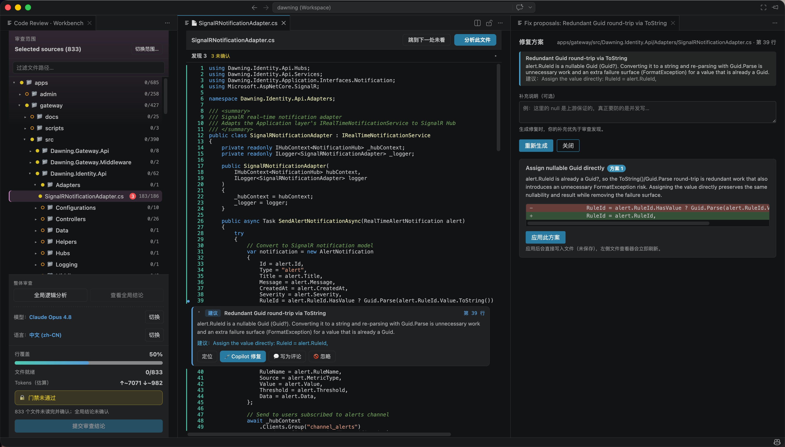

# AI Coding Review

> 以证据驱动代码审查：准备需求依据，核查实现与反证，再由人明确提交审查结论。

[](https://marketplace.visualstudio.com/items?itemName=changjian-wang.ai-coding-review)
[](https://marketplace.visualstudio.com/items?itemName=changjian-wang.ai-coding-review)
[](https://marketplace.visualstudio.com/items?itemName=changjian-wang.ai-coding-review)

VS Code 扩展 · 由 GitHub CLI 与 Copilot 模型驱动

[English](README.md) | 简体中文



## Review vNext

以下说明对应仓库源码构建版本，Marketplace 版本可能不同。上方截图展示的是早期界面。

### 准备

- 选择 PR、当前分支相对明确基线的变更、完整提交快照，或本地源码文件。
- 粘贴需求、读取 UTF-8 Markdown/TXT、导入 GitHub Issue/PR 描述，或读取直接返回 HTTPS 文本的链接。每份最多 64,000 字符，选入材料合计最多 128,000 字符。
- 直接查看需求全文和原文版本；人工明确要求不被模型改写，AI 推导检查点不变成新增验收条件。
- 就地修订要求，或说明理由后标记不适用；开始时一次确认适用性。没有明确要求时仅做技术审查，需求一致性明确标为未评审。

### 审查

- 在一个工作台中查看源码/完整 Diff、业务链、发现和证据。关联材料与正式整文件审查对象分开，不再另设范围弹窗。
- 一键审查所选入口，执行跨文件独立发现，再单独进行反证及业务裁决。未确定的候选必须明确区分关键与非关键前提。
- 既有确认问题必须重新验证，不能因重跑时模型漏报就自动消失；已推翻候选与合理取舍保留追溯。
- 保留修复方案的明确应用与撤销，以及翻译、讲解、笔记和文档工具。应用修复会使审查证据失效，不代表需求已经满足。
- 取消后保留有效部分结果；仅在需求、仓库快照及证据指纹均一致时复用已完成入口。

### 结论

- 一份预览合成报告、审查者补充说明和行内评论；复制、保存使用同一份内容。
- **通过**要求必要审查完整有效、可操作缺陷已处置、没有未决关键冲突/前提，并且只做一次最终人工确认。
- **仅评论/要求修改**可以提交有效部分反馈，不代表批准，也不能解除关键未决项。
- PR 审查始终绑定明确提交；最终确认后再次核对 PR HEAD、仓库证据和预览，异步回包不会批准另一份快照。
- 不在 PR 可行内评论的差异行中的反馈保留到评审正文，避免整份提交因无效行号失败；本地源码的结论只记录在本地。

可见行进度仅辅助阅读，不证明理解，也不是批准门禁。非关键未知和普通上下文预算提示不会一律阻止批准；必要分析缺失、主文件未完整提供、证据过期及关键前提未决会阻止批准。

## 边界与隐私

- 需求及不可覆盖的原文快照保存在本机 VS Code `workspaceState`；选入材料会交给所选 Copilot 模型整理和审查，不会自动发布到 GitHub。
- 直接链接不使用浏览器 Cookie 或站点凭据，不跟随跳转；普通 HTML 网页可改为粘贴原文。
- 导入内容是快照，不会持续监控外部文档；重新读取或导入变化的原文才会产生新版本。
- 固定 PR/分支快照要求位于 Git 根目录、HEAD 一致且工作区干净。请提交/暂存并刷新，或改选本地源码；分支对比本身不会切换分支或自动 stash。
- 仓库上下文及模型输入有明确预算；覆盖限制与非文本排除项会写入报告，省略主文件不会被当作完整审查。
- 引用校验只证明来源、版本与行位置对应，不保证语义正确；模型意见一致不是独立证据，源码审查也不等于执行了测试。
- 扩展不会自动合并 PR，也不能控制 GitHub 分支保护；发布批准始终是人的明确决定。
- 请求数和 `countTokens` 用量均为本地估算，不是服务商账单。

## 语言（双语）

AI Coding Review 全面双语（English / 简体中文），**默认英文**。

- `codereview.language` 驱动**整体体验**——既包括扩展 UI（状态栏、提示、Webview 面板），也包括所有 LLM 输出（findings、修复方案、讲解、全局结论）。
  - `en`（默认）：全部英文
  - `zh-CN`：全部简体中文
  - `auto`：跟随 VS Code 显示语言
- 切换设置**实时生效**——状态栏与已打开的 Webview 面板立即重渲染，无需重载。
- 已确认需求、原文和保存的响应保留原始文字；切换语言影响界面与后续生成，不会让后台翻译悄悄改写已批准的待提交内容。
- 命令面板中的命令标题跟随 **VS Code 显示语言**（静态贡献点的平台限制），通过 `package.nls` 本地化。

## 命令与配置

### 命令

| 命令 | 说明 |
|------|------|
| `codereview.openOrStart` | 打开或开始审查（状态栏入口） |
| `codereview.openInNewWindow` | 在独立窗口打开审查工作台 |
| `codereview.startReview` | 选择范围并开始审查 |
| `codereview.openWorkbench` | 打开审查工作台 |
| `codereview.analyzeFile` | 以当前文件为入口分析相关仓库行为 |
| `codereview.globalAnalysis` | 开始或继续当前范围审查 |
| `codereview.showGlobalReport` | 打开统一结论页 |
| `codereview.submitConclusion` | 打开结论预览，发布需明确操作 |
| `codereview.jumpToNextUnseen` | 跳到下一处未读行 |
| `codereview.pickModel` | 选择分析模型 |
| `codereview.pickLanguage` | 切换体验语言（UI + LLM 输出） |

### 配置

| 配置项 | 默认 | 说明 |
|--------|------|------|
| `codereview.language` | `en` | 整体体验（UI + LLM 输出）的语言：`en` / `zh-CN` / `auto` |
| `codereview.focusedWorkbench` | `false` | 打开工作台时隐藏侧栏 / 活动栏占满主编辑区，关闭后恢复 |
| `codereview.repositoryAwareAnalysis` | `auto` | 构建关联仓库上下文；`off` 只限制文件级分析，不跳过必要全局审查 |
| `codereview.repositoryContextTokenBudget` | `28000` | 仓库上下文最大估算输入 Token；超限时优先移除较低价值的相关片段 |

## 架构分层

```text
src/
  extension.ts          激活入口、命令注册、编排、门禁
  i18n/                 语言解析器 + 中英文消息 catalog
  gh/                   GitHub CLI 封装（auth / pr view / pr diff / 写回 review）
  scope/                审查范围：PR / 分支对比 / 工作树 / 文件选择 + 树形选择器 Webview
  review/               版本化需求、审查编排、门禁、源码访问与持久化
  ai/                   模型选择 + 文件级 / 全局分析 + 修复方案 + 语言指令
  ui/                   三阶段工作台、内嵌源码、文档/修复工具与报告合成
```

## 持久化

- `workspaceState`（本机），按仓库目录及范围/快照隔离；同名目录不会共享需求材料。
- 已应用的修复快照持久化，重载后「撤销修复」与「定位」仍可用。
- 代码和需求变化会使结果/批准证据过期；旧批准、基线及处置理由作为历史，不是新上下文的豁免。阅读位置与笔记单独保留。
- 注意：`workspaceState` **不跟随 GitHub 账号、不跨设备**；跨设备能力通过 `ReviewStore` 接口预留，将来由远端实现提供。

## 模型与语言

- 通过 VS Code Language Model API 列出当前 Copilot 授权的模型，支持 `Auto`，按工作区记住选择。
- `codereview.language` 控制整体体验（UI + 所有 LLM 输出）的语言；详见上文[语言](#语言双语)。

## 开发与打包

```bash
npm install
npm run compile            # 或 npm run watch；按 F5 启动扩展开发宿主
npm test                   # 运行单元测试（vitest）
npm run package            # 生产构建（esbuild --production）
npx @vscode/vsce package   # 生成 .vsix
```

PR 范围与写回 PR 需要本机已安装并登录 GitHub CLI：`gh auth login`。

## 路线图

- [ ] 跨设备 / 跟随账号的审查进度（远端 `ReviewStore` 实现）。
